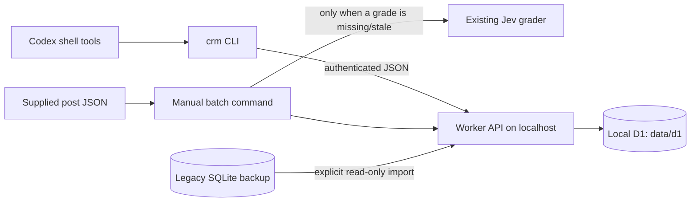

# How the lead agent works

The current working slice is a **local D1 CRM**, an authenticated Worker API,
TypeScript shell tools, manual Jev grading, and deterministic feedback handling.
No Cloudflare account is required to run it. No remote D1 database has been
configured or tested. Reddit fetching, timers, outreach, and hosted application
integration remain pending.

## Current components



[`scripts/local-crm.mjs`](../scripts/local-crm.mjs) bundles the Worker, starts
Miniflare/workerd on loopback, and applies numbered SQL migrations. The installed
Miniflare version uses `resourcePersistencePath`; this is explicitly configured
and verified across a runtime restart. Local runs do not load credential files,
contact Spectrum, or enable notifications. Wrangler's D1 configuration is a
placeholder for later remote setup, not a second running database.

**D1 owns application state.** Every regular batch and CRM mutation goes through
this Worker. SQLite is only a migration source; no code continues writing it.
Do not start a separate Wrangler development store and assume it is the same
CRM. `CRM_URL` selects the authoritative API for every client. A future remote
switch requires transferring and verifying data, not merely changing a URL.

## Records and preservation

| Record | What it preserves |
|---|---|
| `leads` and `lead_revisions` | Stable identity, source post/URL, current grade, earlier distinct post/grade versions, rubric/model versions, current status and submission markers |
| `feedback_history` | Dated verdict/reason, optional inbound event ID; previous feedback remains intact |
| `reports` and `report_items` | Report body, ordered item-to-lead links, immutable post/grade snapshots |
| `notification_submissions` | Platform/message-to-report links, conversation ID and submission time |
| `inbox` | Inbound event identity, original normalized payload, saved processing response for replay suppression |

Lead IDs retain the existing convention: Reddit URL path, or SHA-256 of the
normalized supplied post when there is no URL. The API derives and checks IDs.
Changing a URL-less post changes its identity; changing a post at the same URL
updates that lead and saves the new grade as a revision. Workflow status,
feedback, and prior submission markers survive upserts.

[`0001_cloud.sql`](../migrations/0001_cloud.sql) remains unchanged.
[`0002_crm.sql`](../migrations/0002_crm.sql) adds history and relationship tables;
it copies existing grades, legacy feedback notes, and submission links without
deleting old columns/records. A legacy note with no verdict is tagged `legacy`
and dated when it is migrated, because its original feedback date is unknown.
Existing `runs`/`run_lock` scaffold tables remain unused; no scheduler runs.

The separate SQLite importer reads the old Bun database without modifying it.
It never overwrites an existing D1 lead. Old reports have no trustworthy item
ordering/conversation metadata; imports preserve the relationships with unknown
item indices/conversations. Feedback on those reports requires an explicit lead ID.
There was no legacy SQLite file in this checkout; tests use a populated fixture.

## A manual batch

1. Validate supplied posts; no URL is fetched.
2. Read D1 and reuse unchanged grades for the same rubric; call Jev only when needed.
3. Upsert post/grade through the API and preserve earlier revisions.
4. List unsubmitted, `new`/`useful`, high/urgent leads sorted by score.
5. Save a numbered preview of at most five leads, or submit only through an explicitly enabled live sender.

The existing `algovox-v1` rubric covers upcoming technical interviews, relevant
intern/new-grad recruiting, interview-focused LeetCode, and requests for mock
practice. Score 2.5+ qualifies; 3.5+ is urgent; confidence below 0.5 requires
review. Jev receives untrusted post content separately from rubric instructions.
No new model account or reasoning framework was added. Offline fixtures and
integration tests use saved/fake grades rather than contacting a model.

A preview leaves candidates pending. A successful notification records the
message's platform, conversation ID, report ID, and submission time. Submitted
leads are excluded from future alerts; an edited source does not reset that
marker. Dismissed/contacted leads remain excluded even if their source changes.
`get_lead` exposes feedback for later grading review; the grader currently does
not consume it or train on it automatically.

## Feedback path

```mermaid
sequenceDiagram
  participant Owner
  participant Handler as Spectrum handler
  participant API as CRM Worker
  participant D1
  Owner->>Handler: Reply: Dismiss 2: interview already happened
  Handler->>Handler: Check inbound direction and owner identity
  Handler->>API: Event ID, text, platform, conversation, target message
  API->>D1: Check replay; resolve message → report → item 2 → lead
  alt One known target
    API->>D1: Atomically save inbox response, feedback, and status
    API-->>Handler: Saved verdict and reason
  else Missing or ambiguous target
    API->>D1: Save clarification response for this event
    API-->>Handler: Which lead?
  end
  Handler-->>Owner: Acknowledge once unless event was a replay
```

The cloud iMessage provider in installed Spectrum **12.10.1** normalizes threads
as a `reply` content wrapper. The handler reads nested text and `target.id`; a
stub target with only an ID still works. Multi-item reports require an item
number or explicit lead ID. A bare verdict is accepted only for a one-item
report. Resolution includes platform and conversation; it never picks the
latest report. Unknown targets request clarification without changing leads.
Outgoing messages, non-text content, and non-owner events are ignored.

The `inbox` event key includes platform, conversation, and message ID. A D1
transaction conditionally appends feedback/updates status only while the saved
response is empty. Concurrent and later duplicates return the original result
and never repeat the mutation or acknowledgement. Explicit lead-ID commands
also work through the CLI with no Spectrum connection.

The live receiver preserves echo responses for other owner text. Starting it
requires explicit process opt-in and a CRM that permits notifications. The
local runner never permits those notifications. Live SDK behavior was checked
against the installed contract; actual phone delivery was not tested in this slice.

## Security and local verification

The Worker requires an application bearer token with at least 16 characters.
Tokens come from process environment or a future Worker secret, never tool
arguments. HTTP clients permit cleartext only on loopback and refuse redirects.
Cloudflare account/management tokens are separate and absent from the API.
Requests, arrays, text, statuses, classification values, pagination, and IDs are
validated before writes. All SQL values are parameterized. Database errors do
not expose SQL or credentials to API callers.

`bun --no-env-file run test:d1` runs the actual bundled Worker against local D1,
not a mock. It checks restart persistence, additive migration of existing data,
authentication/validation, report context, history, concurrent replays, SQLite
import, and batch behavior. Credentials, phone identities, sends, and grades in
tests are isolated fixtures. `bun --no-env-file run check` checks TypeScript.
See [README startup/smoke commands](../README.md#two-minute-smoke-test).

Sending a Photon message and committing its submission cannot be one atomic
transaction. A crash between them can create duplicates; delivery reconciliation
is pending before automation. A saved inbound event followed by a failed
acknowledgement can leave feedback persisted without a visible reply. Feedback
persistence is verified; exactly-once network delivery is not claimed.

## Hosting boundaries and next work

The earlier Maritime checkpoint created a separate Codex runtime. It does not
run this receiver, call this CRM, scan Reddit, or provide scheduling integration.
No Maritime state was inspected or changed during this slice. Historical Photon
phone tests do not establish current live delivery after this change.

Local CRM access needs the Worker process running. With the laptop off, this
application has no running API, receiver, grader, or monitor. Remote D1 and
Cloudflare account access are pending; see [Connect Cloudflare later](connect-cloudflare.md).

Next work remains bounded: establish Reddit access, connect the future database
account, review grading against stored feedback, add scanning/scheduling, and
later implement owner-reviewed outreach and hosting integration. The
[README roadmap](../README.md#roadmap) tracks those actions. No cron, cloud
signup, deployment, provisioning, or paid model call was performed here.
